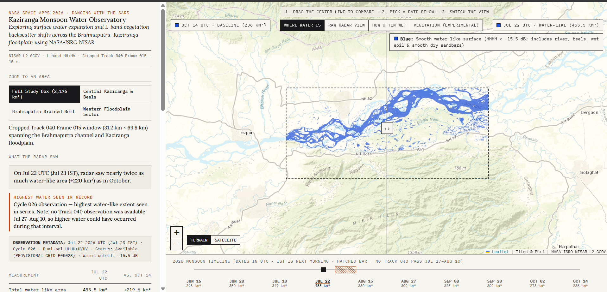
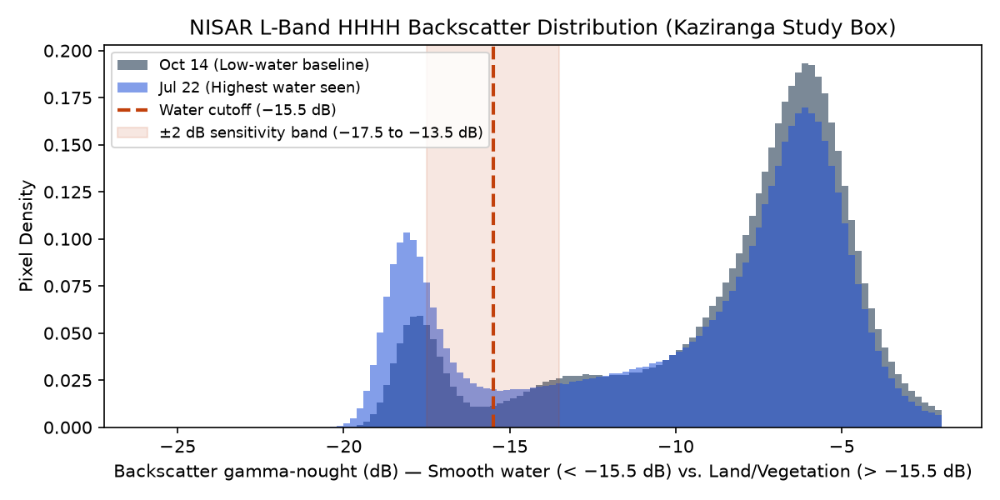

# Kaziranga Monsoon Water Observatory

Exploring seasonal surface-water dynamics and L-band vegetation backscatter shifts across the Brahmaputra–Kaziranga floodplain using NASA-ISRO NISAR radar.

Built for the NASA Space Apps Challenge 2026, *Dancing with the SARs*, by Team The_Larpers.

**Live demo: https://parth-degharia09.github.io/kaziranga-sar-change-detector/**



---

## The problem and context

Kaziranga National Park, on the south bank of the Brahmaputra in Assam, floods every monsoon. Seasonal inundation is ecologically vital: it refills wetlands (beels), sustains alluvial grasslands and clears invasive species. Extreme inundation pushes wildlife south across National Highway 37 toward the Karbi (Mikir) Hills.

Optical satellites are often blocked by monsoon cloud. NISAR's L-band radar (about 24 cm wavelength) images through cloud and darkness every 12 days. This project turns 10 dual-polarization (HHHH + HVHV) NISAR acquisitions into a plain-language interactive explorer.

On 21 July 2026, one day before our highest water-like acquisition, the Kaziranga Divisional Forest Officer reported only four forest camps inundated and no flood emergency ([The Assam Tribune](https://assamtribune.com/assam/no-flood-situation-in-kaziranga-only-4-forest-camps-inundated-dfo-vignesh-1614548)). For that reason the tool describes surface water across the river and floodplain corridor and does not claim a park-wide flood.

## Features

- **Where is the water?** A 10-date timeline (16 Jun – 14 Oct 2026, UTC and IST) with a before/after swipe against the 14 Oct reference, plus a raw dual-pol radar view.
- **How often is an area wet?** A full-width frequency map: occasional (10–30%), frequent (40–70%), persistent (80–100%, 8–10 of 10 passes).
- **How does the vegetation radar response change?** An experimental map of HHHH/HVHV change against 14 Oct over non-water land: increased HH (amber, possible double-bounce) and changed HV (violet, possible canopy or moisture shift).
- **Evidence and export.** Every area has a ±2 dB cutoff sensitivity range, a 12-day NASA IMERG rainfall series, a plain-language headline per date, and CSV download for one date or all dates.

## Key findings

Study window: 2,176.13 km² (Track 040, Frame 015 crop).

| Cycle | Date (UTC) | Local date (IST) | Water-like area (km²) | Extra vs. 14 Oct (km²) | Cutoff check −17.5 → −13.5 dB (km²) | Mean HHHH (dB) | Mean HVHV (dB) | Vegetation radar change (km²) |
|---|---|---|---|---|---|---|---|---|
| 023 | 2026-06-16 | 2026-06-17 | 297.5 | +61.6 (+26%) | 99.1 – 385.8 | -9.20 | -15.37 | 126.3 |
| 024 | 2026-06-28 | 2026-06-29 | 360.4 | +124.5 (+53%) | 191.4 – 443.6 | -9.38 | -15.49 | 138.0 |
| 025 | 2026-07-10 | 2026-07-11 | 347.0 | +111.1 (+47%) | 141.1 – 447.0 | -9.43 | -15.58 | 146.2 |
| 026 | 2026-07-22 | 2026-07-23 | 455.5 | +219.6 (+93%) | 299.0 – 544.4 | -9.62 | -15.65 | 174.8 |
| 028 | 2026-08-15 | 2026-08-16 | 330.4 | +94.5 (+40%) | 143.6 – 422.2 | -8.97 | -15.16 | 141.8 |
| 029 | 2026-08-27 | 2026-08-28 | 309.3 | +73.3 (+31%) | 81.7 – 388.5 | -8.87 | -15.22 | 111.9 |
| 030 | 2026-09-08 | 2026-09-09 | 325.2 | +89.3 (+38%) | 81.0 – 395.1 | -8.74 | -15.19 | 129.3 |
| 031 | 2026-09-20 | 2026-09-21 | 309.3 | +73.4 (+31%) | 43.0 – 387.8 | -8.47 | -14.93 | 85.7 |
| 032 | 2026-10-02 | 2026-10-03 | 277.5 | +41.6 (+18%) | 138.1 – 348.7 | -8.48 | -14.94 | 23.4 |
| 033 | 2026-10-14 | 2026-10-15 | 235.9 | Baseline | 136.6 – 315.4 | -8.36 | -14.76 | 0.0 |

- **Peak:** 22 Jul UTC, 455.5 km² (+219.6 km², +93% over the 14 Oct reference of 235.9 km²). It stays the highest at all three cutoffs (−17.5, −15.5, −13.5 dB).
- **Often-wet area:** 280.04 km² was water-like in 8–10 of the 10 acquisitions (main braided channel and perennial beels). Another 197.37 km² was water-like in 1–7.
- **Consistency check:** the often-wet area is larger than the 14 Oct water area, so at least 44.1 km² of often-wet pixels are not water-like on 14 Oct.
- **Cutoff caveat:** at the strict −17.5 dB cutoff, 16 Jun, 27 Aug, 8 Sep and 20 Sep fall below the 14 Oct value at the same cutoff, so the margin over 14 Oct depends on the cutoff. The ±2 dB band is a sensitivity check, not a confidence interval.
- **Time series:** apart from the 22 Jul peak, water-like area stays between about 300 and 360 km² from mid-June to late September, then falls to 278 and 236 km² in October. The data alone do not show a steady recession.



The −15.5 dB cutoff sits near the valley between the water peak (about −18 dB) and the land peak. The strict −17.5 dB cutoff cuts through the water peak, which is why the sensitivity band is wide.

## Data

| Dataset | Use | Source |
|---|---|---|
| NISAR L2 GCOV, L-band, Track 040, Frame 015, ascending, PROVISIONAL (CRID P05023) | HHHH and HVHV backscatter, 10 m pixels, EPSG:32646 | NASA Earthdata / ASF DAAC |
| GPM IMERG Late Run v07 (`GPM_3IMERGDL`), daily | 12-day rainfall before each pass, averaged over the study box | NASA Giovanni |

The study box is 92.95°E–93.65°E, 26.50°N–26.78°N. There is no Track 040 / Frame 015 observation between 27 July and 10 August 2026 (cycle 027 is missing), so a higher peak may have occurred in that interval.

The 20 GeoTIFFs (`kaziranga_<YYYYMMDD>_HHHH.tif` and `_HVHV.tif`) are kept locally in `The_Larpers/data/raw_tifs/` and are not committed to Git.

## Method

Implemented in `The_Larpers/backend/processing/02_process_nisar.py`:

1. Apply a 5 × 5 (50 m) NaN-aware boxcar speckle filter in linear power, then convert to dB.
2. Water-like surface: HHHH < −15.5 dB, removing patches smaller than 25 pixels (2,500 m²). The same rule at −17.5 and −13.5 dB gives the sensitivity band.
3. Vegetation radar change over non-water land with HVHV > −20 dB on 14 Oct: increased HH (ΔHH > +2.5 dB and ΔHH > ΔHV + 1 dB) or changed HV (|ΔHV| > 2.5 dB), in patches of at least 2,500 m².
4. Frequency map: the fraction of the 10 dates on which each pixel is water-like. Persistent water is 8 or more of 10.
5. Reproject to EPSG:3857 and export PNG overlays, the histogram, and `nisar_metrics.json`.

## Limitations

- **Water-like, not confirmed flood.** Low L-band backscatter marks smooth surfaces: river channels, beels, flooded paddies, wet mudflats and smooth dry sandbars.
- **Cutoff sensitivity is not an uncertainty interval.** At the strict cutoff several dates fall below the 14 Oct value. The 22 Jul peak does not.
- **Flooded vegetation is under-counted.** Water under tall grass or forest can raise HH through double-bounce, so a low-backscatter cutoff misses it. The amber class is only a partial proxy.
- **Baseline and season.** 14 Oct is post-monsoon but not necessarily the seasonal minimum. Vegetation differences mix real change with plant growth and soil moisture.
- **Sampling.** A 12-day revisit and the 27 Jul – 10 Aug gap can miss short flood pulses.
- **Provisional data.** NISAR products are PROVISIONAL and may be reprocessed.
- **Not modelled.** Wind roughening, incidence-angle effects and calibration differences between dates.
- **Not validated against independent flood maps.** The channel contrast comparison uses masks derived from HHHH, so it is not independent evidence.

This is a research and visualization tool, not an operational flood-warning system.

## Run locally

Developed and tested on Windows with the package versions pinned in `requirements.txt`. `rasterio` can be awkward to install on some systems; a prebuilt wheel or conda usually fixes it.

```bash
# 1. Create an environment and install the packages
python -m venv .venv
.venv\Scripts\activate          # macOS/Linux: source .venv/bin/activate
pip install -r requirements.txt

# 2. Place the 20 GeoTIFFs in The_Larpers/data/raw_tifs/

# 3. Check CRS, pixel spacing, shape and units
python The_Larpers/backend/processing/01_inspect_tifs.py

# 4. Generate overlays, histogram and nisar_metrics.json
python The_Larpers/backend/processing/02_process_nisar.py

# 5. Serve the web app
cd The_Larpers/frontend
python -m http.server 8000      # open http://localhost:8000
```

The app loads Leaflet, Chart.js, Tailwind and Esri basemap tiles from the internet, so it needs a connection.

## Repository structure

```
kaziranga-sar-change-detector/
├── .github/
│   └── workflows/
│       └── ci-pages.yml                    # CI and GitHub Pages deployment
├── .gitignore
├── LICENSE
├── README.md
├── requirements.txt                        # Pinned Python packages for the processing scripts
└── The_Larpers/
    ├── backend/
    │   └── processing/
    │       ├── 01_inspect_tifs.py          # Audits CRS, pixel spacing, shape and units of the 20 GeoTIFFs
    │       └── 02_process_nisar.py         # Speckle filter, dB, water/vegetation classes, IMERG rainfall, PNG/JSON export
    ├── data/
    │   ├── imerg_kaziranga_2026.csv        # GPM IMERG Late Run v07 daily rainfall, 2026-06-01 to 2026-10-15
    │   └── raw_tifs/                       # Local only: 20 NISAR GeoTIFFs (ignored by Git)
    ├── docs/
    │   ├── hh_histogram.png                # HHHH distribution and −15.5 dB cutoff
    │   └── screenshot.png                  # App screenshot used at the top of this README
    └── frontend/
        ├── index.html                      # Leaflet + Chart.js web app
        └── data/
            ├── nisar_metrics.json          # Areas, ±2 dB bounds, 12-day rainfall, metadata
            ├── inundation_frequency.png    # 10-date wetness frequency overlay
            ├── water_YYYYMMDD.png          # Water-like extent overlays (10)
            ├── rgb_YYYYMMDD.png            # Dual-pol false-colour overlays, R:HH G:HV B:HH−HV (10)
            └── veg_YYYYMMDD.png            # Experimental vegetation change overlays (10)
```

## Credits

- NISAR L2 GCOV: NASA-ISRO, distributed by the Alaska Satellite Facility DAAC (NASA Earthdata).
- Rainfall: NASA GPM IMERG Late Run v07 (Huffman et al., 2023), via NASA Giovanni.
- Basemaps: Esri World Topo Map and World Imagery. Libraries: Leaflet, Chart.js, Tailwind CSS.
- Python packages: NumPy, SciPy, scikit-image, rasterio, Matplotlib, Pillow.


## License

See [LICENSE](LICENSE).

